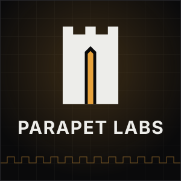

# Public audits

[Parapet Labs](https://parapetlabs.net) is a Web3 security firm. Through expert-led research and AI-assisted analysis, we help complex DeFi and Web3 protocols uncover critical vulnerabilities before attackers do.

  
  

## Read our published work

This repository is the home of our public work: audit reports, contest findings and write-ups from our team, covering **EVM** and **Solana** protocols. Each report lists the findings by severity, where the issue is, what an attacker can do with it, and how to fix it.

## Engagements

|Protocol|Description|With|Findings|Report|
|:--|:--|:--|:--|:-:|
|[QuantumAMM](https://x.com/QuantumAMM)|Solana Pinocchio propertyAMM|[Sanad Squad](https://sanadsquad.com/)|1H, 5M, 7L, 14I, 1G|Private|
|Private|Solana anchor Fiat-backed stablecoins|Solo|2C, 2H, 2M, 13L|-|
|[Lista Liquid Staking](https://lista.org/)|Sub staker contract to split voting power of the liquid staking|[BailSec](https://bailsec.io/)|Private|-|
|[BNB PropAMM Standard](https://github.com/asiawildboar/BEPs/blob/a237e9f756afaaf20aea120e7172ad84e7ae5c70/BAPs/BAP-710.md)|BAP-710 PropAMM on-chain standard to facilitate maker/taker/relayer off-chain relations|[BailSec](https://bailsec.io/)|Private|-|
|[PanCakeSwap infinity hooks](https://pancakeswap.finance/)|JIT liquidity hook farming yields|[BailSec](https://bailsec.io/)|3M, 16L, 8I|-|
|[BNB Chain](https://github.com/bnb-chain/BEPs/blob/master/BEPs/BEP-677.md)|BEP-677 Scaled UI Amount|[Pashov Audit Group](https://www.pashov.com/)|5L|[📄](https://github.com/pashov/audits/blob/5f5b1823c0cdb4d0f3fc9bd391257eb900d99989/team/pdf/BNBChain-security-review_2026-04-30.pdf)|
|[Jet Stream Vaults](https://www.jetstream.markets/)|yield farming|[Pashov Audit Group](https://www.pashov.com/)|2C, 5M, 18L|-|
|[Reserve](https://reserve.org/)|Reserve Governor Protocol|[Pashov Audit Group](https://www.pashov.com/)|2M, 11L|[📄](https://github.com/pashov/audits/blob/699447cf6a70e499cd22a9e91b2ae1f677ca2972/team/pdf/Reserve-security-review_2026-02-27.pdf)|
|[MegPrimePay](https://linktr.ee/MegPrimePay)|ERC20 token with anti-sniper tax mechanisms applied to AMM pool interactions|[Pashov Audit Group](https://www.pashov.com/)|2M, 9L|-|
|[Monarch](https://monarch.fast/)|hub-and-spoke rewards and treasury router|[Pashov Audit Group](https://www.pashov.com/)|1M, 18L|-|
|[Top Strike](https://www.topstrike.io/)|Player cards IPO and quadratic bonding curve trading|[Pashov Audit Group](https://www.pashov.com/)|3M, 16L|[📄](https://github.com/pashov/audits/blob/master/team/pdf/TopStrike-security-review_2025-12-18.pdf)|
|[Kinetiq](https://kinetiq.xyz/)|HyperLiquid liquid staking|[Pashov Audit Group](https://www.pashov.com/)|5M, 8L|-|
|[Sofamon](https://www.sofamon.xyz/)|NFTs royalty management|[Pashov Audit Group](https://www.pashov.com/)|1C, 1M, 10L|[📄](https://github.com/pashov/audits/blob/master/team/pdf/WishWish-security-review_2025-11-04%20\(1\).pdf)|

## Bug Bounties

|Project|Category|Severity|Report|
|---|---|---|---|
|Common Wealth|Staking and on-chain VC|High|Private|

## Contests Judged

|Contest|Data|Description|Platform|
|---|---|---|---|
|[Pare Stocks](https://parestocks.com/)|Sep 2026|Robinhood stock tokens on Robinhood Chain, split into a principal token and a yield token|Pashov Auditing Group|
|[mev-commit](https://cantina.xyz/competitions/217af22c-957e-4c13-bc2a-1d5255e72309)|Sep 2025|Primev’s L1 smart contracts for routing builder payments, distributing validator stipends, and managing bidder deposits.|Cantina|
|[Succinct Staking](https://cantina.xyz/code/bd882748-077e-4e55-853f-f8df70109dbb/overview)|Jul 2025|Staking logic of the [succinct network](https://www.succinct.xyz/)|Cantina|
|[Aquarius AMM](https://cantina.xyz/competitions/990ce947-05da-443e-b397-be38a65f0bff)|May 2025|AMM rust protocol on stellar chain implementing Curve stable swap and UniV2|Cantina|
|[ZKP2P V2](https://audits.sherlock.xyz/contests/805)|April 2025|Escrow contracts integrated with ZK off-chain logic|Sherlock|
|[Gamma Limit Order](https://cantina.xyz/competitions/aaf79192-6ea7-4b1e-aed7-3d23212dd0f1)|April 2025|A limit order protocol based on UniV4 Hook|Cantina|

### Audit Contests

| Contest                                                                                                                                             | Date      | Description                                             | Findings                                                                                                                                      |                                                           Rank                                                            |                                                   Report                                                    |
| :-------------------------------------------------------------------------------------------------------------------------------------------------- | --------- | :------------------------------------------------------ | :-------------------------------------------------------------------------------------------------------------------------------------------- | :-----------------------------------------------------------------------------------------------------------------------: | :---------------------------------------------------------------------------------------------------------: |
| [Infrared Finance](https://cantina.xyz/competitions/ac5f64e6-3bf2-4269-bbb0-4bcd70425a1d)                                                           | Jan 2025  | LST in Bera chain                                       | [4H, 3M(1 solo), 3L, 3I](Contests/2025-01-infrared.md)                                                                                        |             [1st](https://cantina.xyz/competitions/ac5f64e6-3bf2-4269-bbb0-4bcd70425a1d/leaderboard)   🥇              |                                                      -                                                      |
| [QuantAMM](https://codehawks.cyfrin.io/c/2024-12-quantamm)                                                                                          | Jan 2025  | Custom BalancerV3 Pools + custom hook integration       | [8H, 8M (2 solo), 3L](Contests/2025-01-QuantAmm.md)                                                                                           | [1st](https://codehawks.cyfrin.io/c/2024-12-quantamm/results?lt=contest&page=1&sc=reward&sj=reward&t=leaderboard)   🥇 | [📄](https://codehawks.cyfrin.io/c/2024-12-quantamm/results?lt=contest&page=1&sc=reward&sj=reward&t=report) |
| [CTU blockchain Labs](https://czm.fel.cvut.cz/blockchain-lab)                                                                                       | May 2026  | ERC6909 Bond Platform                                   | 4M                                                                                                                                            |                                [2nd🥈](https://x.com/CODESPECT/status/2071569907976692194)                                |                                                      -                                                      |
| [EigenLayer-Core](https://cantina.xyz/competitions/e7af4986-183d-4764-8bd2-1d6b47f87d99)                                                            | Mars 2025 | Restaking Protocol                                      | [1H](Contests/2025-03-EigenLayer.md#casting-overflow-ineigenpodmanagerremovedepositsharescauses-operators-to-participate-with-no-backing-eth) |                 [6th](https://cantina.xyz/competitions/e7af4986-183d-4764-8bd2-1d6b47f87d99/leaderboard)                  |                                                      -                                                      |
| [Nest exchange - previously FenixFinance](https://app.hats.finance/audit-competitions/fenix-0x9d7765a7ebd5b6322a30797a44a5428531970d3d/leaderboard) | Jul 2024  | Smart Dex                                               | [1M (1 Solo)](Contests/2024-07-Fenix.md)                                                                                                      |  [2nd](https://app.hats.finance/audit-competitions/fenix-0x9d7765a7ebd5b6322a30797a44a5428531970d3d/leaderboard)   🥈  |       [📄](https://github.com/hats-finance/Fenix--0x9d7765a7ebd5b6322a30797a44a5428531970d3d/issues)        |
| [Gamma - Brevis Rewarder](https://audits.sherlock.xyz/contests/496)                                                                                 | OCT 2024  | Liquidity Management                                    | [1H](Contests/2024-10-Gamma.md)                                                                                                               |                            [3rd](https://audits.sherlock.xyz/contests/496/leaderboard)   🥉                            |                            [📄](https://audits.sherlock.xyz/contests/496/report)                            |
| [Alchemix Transmuter](https://codehawks.cyfrin.io/c/2024-12-alchemix)                                                                               | Dec 2024  | Yearn V3 Tokenized Vault Integration                    | [3M](Contests/2024-12-alchemix.md)                                                                                                            | [4th](https://codehawks.cyfrin.io/c/2024-12-alchemix/results?lt=contest&page=1&sc=reward&sj=reward&t=leaderboard)   🏅 | [📄](https://codehawks.cyfrin.io/c/2024-12-alchemix/results?lt=contest&page=1&sc=reward&sj=reward&t=report) |
| [Munchables - LandManager](https://code4rena.com/audits/2024-07-munchables)                                                                         | July 2024 | GameFi, Point Farming                                   | [3H, 1L](Contests/2024-07-munchables.md)                                                                                                      |                              [5th](https://code4rena.com/audits/2024-07-munchables)   🏅                               |                           [📄](https://code4rena.com/reports/2024-07-munchables)                            |
| [fLayer](https://audits.sherlock.xyz/contests/468?filter=results)                                                                                   | Sep 2024  | Liquidity protocol for NFTs with custom Uniswap V4 hook | [8H , 6M (1 solo)](Contests/2024-08-flayer.md)                                                                                                |                            [5th](https://audits.sherlock.xyz/contests/468/leaderboard)   🏅                            |                            [📄](https://audits.sherlock.xyz/contests/468/report)                            |
| [Olas](https://code4rena.com/audits/2026-01-olas)                                                                                                   | jan 2026  | AI agents                                               | [2H,1M,15L](Contests/2026-01-olas.md)                                                                                                         |                                    [4th](https://code4rena.com/audits/2026-01-olas)🏅                                     |                                                      -                                                      |
| [VeChain Stargate SC DualDefense Audit (RND 2)](https://hackenproof.com/audit-programs/vechain-stargate-sc-dualdefense-audit-rnd-2)                 | nov 2025  | Staking & Delegation Protocol                           | [1C](Contests/2025-011-vechain-stargate.md)                                                                                                   |                                                           2nd🏅                                                           |    [📄](https://hackenproof.com/audit-programs/vechain-stargate-sc-dualdefense-audit-rnd-2?tab=reports)     |
| [gamma-brevis-rewarder](https://audits.sherlock.xyz/contests/496)                                                                                   | Oct 2024  | Active liquidity management, ZK Proofs                  | [1 M](Contests/2024-10-gamma-brevis-rewarder.md)                                                                                              |                                                          3rd 🥉                                                           |                            [📄](https://audits.sherlock.xyz/contests/466/report)                            |
| [QuantAMM](https://codehawks.cyfrin.io/c/2024-12-quantamm)                                                                                          | Dec 2024  | Automated Market Maker (AMM) / DEX                      | [6H, 3M, 2L](Contests/2024-12-quantamm.md)                                                                                                    |                                                            6th                                                            | [📄](https://codehawks.cyfrin.io/c/2024-12-quantamm/results?lt=contest&page=1&sc=reward&sj=reward&t=report) |
| [OKU](https://audits.sherlock.xyz/contests/641)                                                                                                     | Nov 2024  | Trading frontend for Uniswap v3 / DeFi UX tooling       | [5H, 2M ](Contests/2024-12-OKU.md)                                                                                                            |                                [7th](https://audits.sherlock.xyz/contests/641/leaderboard)                                |                            [📄](https://audits.sherlock.xyz/contests/641/report)                            |
| [EigenLayer-Core](https://cantina.xyz/competitions/e7af4986-183d-4764-8bd2-1d6b47f87d99)                                                            | Mar 2025  | Restaking infrastructure / LRTs / AVS                   | [1H](Contests/eigenlayer-contracts.md)                                                                                                        |                                                            7th                                                            |                                                      -                                                      |
| [Metropolis / liquidity-book-vaults](https://cantina.xyz/competitions/076935b1-2706-48c6-bf0a-b3656aa24194)                                         | Apr 2025  | Liquidity manegement                                    | [1H,5M(1solo),2Info](Contests/liquidity-book-vaults.md)                                                                                       |                                                            7th                                                            |                                                      -                                                      |
| [Sablier-Flow](https://codehawks.cyfrin.io/c/2024-10-sablier)                                                                                       | Oct 2024  | Streaming payments / Token vesting                      | [1 L](Contests/2024-10-sablier.md)                                                                                                            |                                                            8th                                                            |                 [📄](https://codehawks.cyfrin.io/c/2024-10-sablier/results?t=report&page=1)                 |
| [Vechain \| Stargate Hayabusa](https://immunefi.com/audit-competition/audit-comp-vechain-stargate-hayabusa/information/)                            | oct 2025  | On-Chain Staking & Delegation Protocol                  | [2H](Contests/2025-010-vechain-stargate.md)                                                                                                   |                                                             -                                                             |                                                   [📄]()                                                    |
| [Midas - Instant Minter/Redeemer](https://audits.sherlock.xyz/contests/495)                                                                         | Aug 2024  | RWA, real world asset tokenization                      | [1 M](Contests/2024-08-midas-minter-redeemer.md)                                                                                              |                                                           11th                                                            |                            [📄](https://audits.sherlock.xyz/contests/495/report)                            |
| [Belong](https://immunefi.com/audit-competition/audit-comp-belong/information/)                                                                     | oct 2025  | Web3 Engagement Protocol / Tokenization Layer           | [1C](Contests/2025-010-belong.md)                                                                                                             |                                                             -                                                             |                                                   [📄]()                                                    |
| [Symmio, Staking and Vesting](https://audits.sherlock.xyz/contests/838)                                                                             | mar 2025  | Synthetic trading / derivatives protocol                | [1M](Contests/2025-03-symm-io-stacking.md)                                                                                                    |                                                           15th                                                            |                            [📄](https://audits.sherlock.xyz/contests/838/report)                            |
| [Hybra Finance](https://code4rena.com/audits/2025-10-hybra-finance)                                                                                 | oct 2025  | LP Vaults/ Staking                                      | [1M,2L](Contests/2025-10-hybra-finance.md)                                                                                                    |                                                             -                                                             |                          [📄](https://code4rena.com/reports/2025-10-hybra-finance)                          |
| [super DCA Liquidity Network](https://audits.sherlock.xyz/contests/1171)                                                                            | sep 2025  | staking, uniV4 hook                                     | [2H,2M](Contests/2025-09-super-dca.md)                                                                                                        |                                                             -                                                             |                           [📄](https://audits.sherlock.xyz/contests/1171/report)                            |
| [Succinct-network](https://cantina.xyz/code/bd882748-077e-4e55-853f-f8df70109dbb/overview)                                                          | jul 2025  | governance                                              | [1L,1I](Contests/succinct-network.md)                                                                                                         |                                                             -                                                             |                                                      -                                                      |
| [Infrared Finance](https://cantina.xyz/competitions/ac5f64e6-3bf2-4269-bbb0-4bcd70425a1d)                                                           | Jan 2025  | LST in Bera chain                                       | [1M](Contests/infrared-contracts.md)                                                                                                          |                                                             -                                                             |                                                      -                                                      |
| [SecondSwap](https://code4rena.com/audits/2024-12-secondswap)                                                                                       | Dec 2024  | Stablecoin swap / DEX (Curve-style)                     | [2H, 1M, 2L](Contests/2024-12-secondswap.md)                                                                                                  |                                                             -                                                             |                           [📄](https://code4rena.com/reports/2024-12-secondswap)                            |

# Contact us

            
